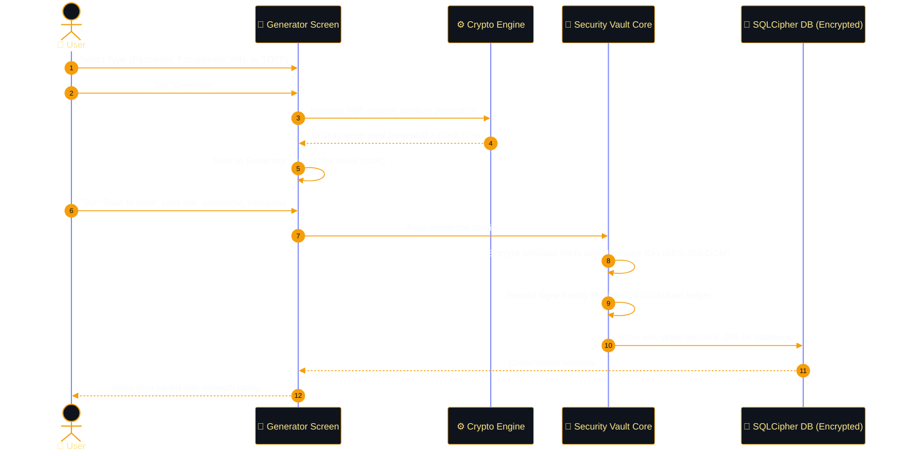
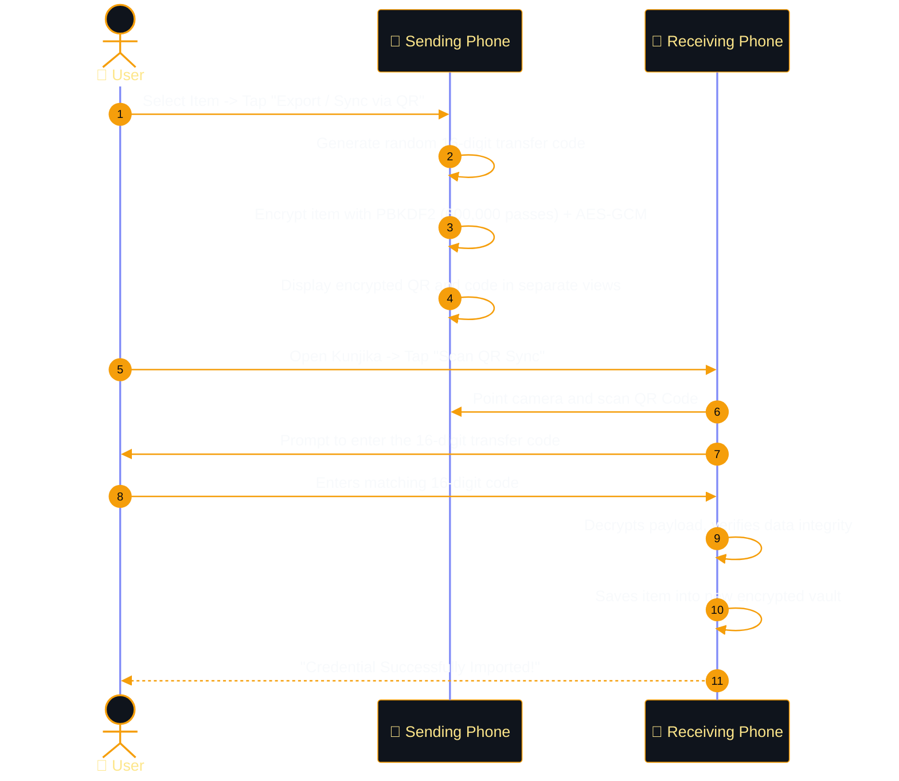
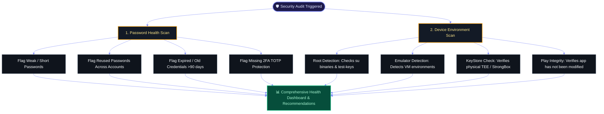

# 🏰 Kunjika

### *A Local-First Encrypted Password Vault & Generator for Android*

[](RELEASE_NOTES.md)
[-818CF8?style=flat-square&labelColor=1E1B4B&color=818CF8)](https://developer.android.com)
[](docs/features.md)
[](docs/security.md)
[](https://dwinsi.github.io/kunjika/web-companion/)
[](LICENSE)

---

## 💡 What is Kunjika?

Most password managers store your passwords on a company's cloud server. If that company is hacked, your digital life is exposed.

**Kunjika is fundamentally different.** It acts like a hardware-secured digital vault that lives **strictly on your phone**.
- **No Cloud. No Accounts. No Internet Permission.** The Android app has no ordinary internet access; local sharing features still transfer selected data over Bluetooth, QR, clipboard, Autofill, or exports.
- **Local-first storage**: Vault data is encrypted on-device. Sharing or copying a credential moves it into the security boundary of the receiving device or app.

> 📖 **New to Kunjika? Check out our visual [User Guide & Step-by-Step Walkthrough](docs/user-guide.md)** with screenshots and everyday use cases!  
> 🧪 **Participating in Closed Beta? Open the interactive [14-Day Play Store Testing Portal](https://dwinsi.github.io/kunjika/testing.html)** to track your daily testing missions and review instructions!

---

## 🌟 Key Features (In Plain English)

| Feature | What It Does | Why It Matters to You |
| :--- | :--- | :--- |
| **🚫 No Android Internet Permission** | The app has no `INTERNET` permission. | Ordinary internet connections are unavailable. Local transfer and clipboard features still share data with other devices or apps. |
| **🔐 Encrypted Local Vault** | SQLCipher uses a random passphrase wrapped by Android Keystore; hardware backing varies by device. | Protects copied database files. The Master PIN is an app access gate, not the database encryption key; root or app-process compromise can bypass it. |
| **🎯 4-in-1 Smart Generator** | Generates strong passwords, multi-word passphrases (like `correct-horse-battery-staple`), numeric PINs, or 2FA secrets. | You never have to invent or reuse passwords again, and newly generated items are saved in an instant history list. |
| **⏰ Built-In 2FA Authenticator** | Generates rotating 6-digit two-factor codes with animated countdown timers. | No need for a separate app like Google Authenticator; your logins and 2FA codes live securely in one place. |
| **⚡ Web Drop (Send to PC)** | Beam passwords from your phone to your computer browser using Bluetooth & QR code. | No typing 30-character passwords on your PC keyboard, no cables, and no cloud relays. |
| **📱 Phone-to-Phone QR Transfer** | Move credentials between two phones by scanning a secure, encrypted QR code. | Transfer passwords to a new phone without using cloud backups, cables, or Wi-Fi. |
| **💎 Biometric Unlock** | Use a supported biometric to authorize convenient unlock. | The PIN exists in app memory during use; device compromise can expose it. |
| **🛡️ Local Audit Chain** | A local HMAC-protected chain records vault changes. | Can help detect some edits; it is not immutable and cannot reliably detect full deletion or rollback. |
| **🔍 Phone Health & Vault Audit** | Scans your vault for weak or repeated passwords, and checks your phone for root or tampering. | Keeps your digital security hygiene at 100% and warns you if your operating system environment is unsafe. |
| **🎨 Obsidian Gold & Platinum Themes** | Built with high-contrast dark and light modes, 3D specular reflections, and frosted glass components. | A refined, ergonomic interface designed for clarity and aesthetic focus. |

---

## 🎯 Handled Use Cases & Step-by-Step Flow Diagrams

Below are the primary use cases handled by Kunjika, illustrated with numbered step-by-step flows.

---

### Use Case 1: Generating & Saving a New Password or 2FA Code
*How Kunjika generates cryptographically secure passwords and stores them under double-lock encryption.*



1. **Choose Type**: Pick between standard passwords, readable multi-word passphrases, numeric PINs, or 2FA authenticator keys.
2. **Generate**: The app uses hardware-grade randomness and estimates how many centuries it would take a supercomputer to crack it.
3. **History Logging**: The item is logged in your local generation history so you don't lose it if you accidentally navigate away.
4. **Keystore Encryption**: When saved, sensitive fields are encrypted with a key protected by Android Keystore; hardware backing varies by device.
5. **Database Storage**: The encrypted record is committed to the encrypted database, and a digital signature is recorded in your audit log.

---

### Use Case 2: Sending a Password to Your Computer (Web Drop)
*How to log in to websites on your desktop or laptop without typing passwords or using the cloud.*

```mermaid
%%{init: {
  'theme': 'base',
  'themeVariables': {
    'darkMode': true,
    'background': '#07090E',
    'actorBkg': '#0F141C',
    'actorBorder': '#F59E0B',
    'actorTextColor': '#FDE68A',
    'actorLineColor': '#818CF8',
    'signalColor': '#F59E0B',
    'signalTextColor': '#F8FAFC',
    'labelBoxBkgColor': '#0F141C',
    'labelBoxBorderColor': '#818CF8',
    'labelTextColor': '#F8FAFC',
    'loopTextColor': '#FDE68A',
    'noteBkgColor': '#1E1B4B',
    'noteBorderColor': '#818CF8',
    'noteTextColor': '#E0E7FF',
    'activationBorderColor': '#F59E0B',
    'activationBkgColor': '#131A26',
    'sequenceNumberColor': '#07090E'
  }
}}%%
sequenceDiagram
    autonumber
    actor User as 👤 User
    participant PC as 💻 Web Companion (Browser)
    participant Phone as 📱 Kunjika App
    participant BLE as 📡 Web Bluetooth (Direct Link)

    User->>PC: Open Web Companion (Offline HTML)
    PC->>PC: Generate an ephemeral ECDH key and session ID
    PC->>PC: Display dynamic QR Code on computer screen
    User->>Phone: Open Credential -> Tap "Send to PC"
    Phone->>PC: Scan QR Code using phone camera (Reads PC's Public Key)
    Phone->>User: Prompt for Fingerprint / Face authentication
    User->>Phone: Biometric approved
    Phone->>BLE: Start advertising and establish ECDH session
    PC->>User: Display transcript-derived 6-digit comparison code
    User->>PC: Confirm matching code
    User->>Phone: Approve sending
    Phone->>BLE: Connect directly to PC over Bluetooth Low Energy
    Phone->>BLE: Stream encrypted password (AES-256-GCM)
    BLE->>PC: Deliver encrypted payload
    PC->>PC: Decrypt directly into volatile RAM
    PC->>User: Display password for explicit reveal or copy
    Note over PC: Closing clears visible fields best-effort; JS memory erasure is not guaranteed
```

1. **Open Web Companion**: On your computer browser, open the [Web Companion](https://dwinsi.github.io/kunjika/web-companion/). It runs entirely in your browser's local memory.
2. **Scan the Screen**: On your phone, tap "Send to PC" and scan the QR code displayed on your monitor.
3. **Hardware Biometric Gate**: Approve the transfer on your phone with your fingerprint or face.
4. **Direct Bluetooth Stream**: The phone encrypts the password and sends it directly to your computer's Bluetooth antenna (range: 1–2 meters). Zero internet or cloud servers involved.
5. **Visual Code Check**: Compare the transcript-derived six-digit codes on both screens before confirming in the browser and approving the send on the phone. This helps detect session substitution but does not authenticate the hosted page itself.
6. **Copy only when needed**: The companion does not auto-copy. Clipboard history and host software can retain anything copied; closing the view only clears visible fields on a best-effort basis.

---

### Use Case 3: Transferring Passwords Between Two Phones (Encrypted QR Sync)
*How to migrate passwords to a new phone with complete privacy.*



1. **Select Item**: Choose any credential to transfer on your current phone.
2. **Dynamic Encryption**: The phone encrypts the credential using a random 16-digit code and creates an encrypted QR pattern. The QR and code appear separately; do not capture both together.
3. **Scan with New Phone**: Open Kunjika on your new phone and point the camera at the first screen.
4. **Enter Code**: Type the 16-digit transfer code.
5. **Instant Import**: The new phone validates the integrity of the data and securely adds it to your new vault.

---

### Use Case 4: Vault Health & Phone Security Audit
*How Kunjika continuously protects you from compromised devices and weak passwords.*



---

## 🏗️ System Architecture & Component Breakdown

Kunjika follows **Security-First Clean Architecture**, separating user interface controls from core cryptographic operations.

```mermaid
%%{init: {
  'theme': 'base',
  'themeVariables': {
    'darkMode': true,
    'background': '#07090E',
    'mainBkg': '#0F141C',
    'primaryColor': '#131A26',
    'primaryTextColor': '#F8FAFC',
    'primaryBorderColor': '#F59E0B',
    'lineColor': '#F59E0B',
    'clusterBkg': '#0F141C',
    'clusterBorder': '#2B374A',
    'edgeLabelBackground': '#18202E'
  }
}}%%
graph TB
    subgraph UI ["🎨 1. Presentation Layer (Jetpack Compose)"]
        A[Auth & Lock Screen]
        B[Vault & Credential Details]
        C[4-in-1 Generator Engine]
        D[Security & Health Audit]
        E[Web Drop QR & BLE Dialog]
    end

    subgraph VM ["🧠 2. Controller Layer (ViewModels)"]
        F[AuthViewModel]
        G[VaultViewModel]
        H[GeneratorViewModel]
        I[SettingsViewModel]
    end

    subgraph Core ["🛡️ 3. Security & Cryptographic Core"]
        J[KeystoreManager<br/><b>Hardware TEE / StrongBox</b>]
        K[BiometricKeyManager<br/><b>BiometricPrompt CryptoObject</b>]
        L[BlockchainManager<br/><b>Local Tamper-Proof Ledger</b>]
        M[WebDropCrypto & BLE<br/><b>ECDH P-256 + GATT Server</b>]
        N[QrEncryptionManager<br/><b>PBKDF2 100k + AES-GCM</b>]
        O[Security & Integrity<br/><b>Root, Emulator & Play Integrity</b>]
    end

    subgraph Storage ["💾 4. Encrypted Storage Layer"]
        P[(SQLCipher Database<br/><b>256-bit AES SQLite</b>)]
        Q[(Encrypted DataStore<br/><b>Hardware-Backed Preferences</b>)]
    end

    UI --> VM
    VM --> Core
    Core --> Storage

    classDef goldNode fill:#131A26,stroke:#F59E0B,stroke-width:1.5px,color:#F8FAFC;
    classDef indigoNode fill:#1E1B4B,stroke:#818CF8,stroke-width:1.5px,color:#E0E7FF;
    classDef emeraldNode fill:#064E3B,stroke:#34D399,stroke-width:1.5px,color:#A7F3D0;
    classDef storageNode fill:#18202E,stroke:#FBBF24,stroke-width:2px,color:#FDE68A;

    class A,B,C,D,E goldNode;
    class F,G,H,I indigoNode;
    class J,K,L,M,N,O emeraldNode;
    class P,Q storageNode;

    style UI fill:#0F141C,stroke:#F59E0B,stroke-width:2px,color:#FDE68A
    style VM fill:#151238,stroke:#818CF8,stroke-width:2px,color:#C7D2FE
    style Core fill:#052e25,stroke:#34D399,stroke-width:2px,color:#A7F3D0
    style Storage fill:#18202E,stroke:#FBBF24,stroke-width:2px,color:#FDE68A
```



---

### Detailed Component Explanations

| Layer | Component | What It Does in Simple Terms | Technical Backing |
| :--- | :--- | :--- | :--- |
| **1. Presentation** | **Compose UI & Glossy Theme** | Renders all screens, high-contrast dark/light themes, 3D specular shine reflections, and interactive dialogs. | Jetpack Compose, Material 3, custom glossy canvas modifiers. |
| **2. Controller** | **ViewModels** | Coordinates user actions, handles input validation, and ensures data is passed cleanly to the cryptographic engine. | Android Architecture Components, StateFlow, Coroutines. |
| **3. Security Core** | **`KeystoreManager`** | Generates and manages the Master Encryption Key in Android Keystore. | Android Keystore; hardware backing varies by device. |
| **3. Security Core** | **`BiometricKeyManager`** | Connects your fingerprint or face scan directly to cryptographic ciphers so your PIN is unlocked without storing plaintext. | `BiometricPrompt.CryptoObject`, AES-256-GCM. |
| **3. Security Core** | **`BlockchainManager`** | Records vault modifications in a local signed audit chain with known deletion and rollback limitations. | Elliptic Curve (`secp256r1`) signatures and HMAC digests. |
| **3. Security Core** | **`WebDropCrypto` & `BLE`** | Enables direct, wireless password sharing to desktop browsers with zero cloud relays. | Web Bluetooth GATT server, ephemeral ECDH P-256, HKDF-SHA-256, AES-GCM. |
| **3. Security Core** | **`QrEncryptionManager`** | Encrypts phone-to-phone data transfer packages into scannable QR codes. | PBKDF2-HMAC-SHA-256 (600,000 iterations), AES-256-GCM, random 16-digit code. |
| **3. Security Core** | **`PlayIntegrity` & `Security`** | Continuously evaluates device environment to ensure the app is running safely. | Root detection heuristics, emulator checks, Google Play Integrity API. |
| **4. Storage** | **SQLCipher Database** | Stores your encrypted credentials, URLs, and notes on flash memory with cryptographically hardened 256-bit encryption. | SQLCipher SQLite engine, AES-256-CBC with HMAC-SHA512. |
| **4. Storage** | **Encrypted DataStore** | Stores application configuration, theme choices, and salt values securely. | AndroidX DataStore with hardware-encrypted preferences. |

---

## 🔒 Security & Privacy Comparison

| Security Feature | Standard Cloud Password Managers | Kunjika Sovereign Vault |
| :--- | :---: | :---: |
| **Network Exposure** | Cloud connectivity varies | Android app has no `INTERNET` permission; local sharing paths remain |
| **Data Storage Location** | Cloud or local, depending on product | Encrypted local database; Keystore hardware backing varies |
| **Phone-to-PC Sharing** | Product-dependent | Direct Bluetooth transfer after user confirmation; receiving computer is trusted |
| **Database Encryption** | Product-dependent | SQLCipher passphrase wrapped by Android Keystore; Master PIN gates the UI |
| **Tamper Detection** | Product-dependent | Local signed audit chain detects some edits; cannot assure deletion or rollback detection |
| **Account Creation** | Requires Email, Password, Subscription | 🛡️ **Zero account, zero personal data collected** |
| **Screen Leak Protection** | Often optional or partial | 🛡️ **System-wide `FLAG_SECURE` blocks screenshots & recordings** |

---

## 🛠️ Technology Stack

- **Platform**: Android 15+ (Min API 35)
- **Language**: Kotlin 2.2.10 (100% Coroutines & Flow)
- **UI Framework**: Jetpack Compose (BOM 2025.02.00) with Material 3 & Custom Glossy Architecture
- **Database**: Room 2.8.4 + SQLCipher 4.6.1 (256-bit AES)
- **Biometrics**: AndroidX Biometric 1.2.0-alpha05 (`CryptoObject`)
- **Integrity**: Google Play Integrity API 1.6.0 + Hardware Attestation
- **Web Drop Companion**: Vanilla HTML5, CSS3, Web Bluetooth API, SubtleCrypto WebCrypto API

---

## 📚 Further Documentation

- [📖 User Guide & Quickstart (Screenshots & Use Cases)](docs/user-guide.md)
- [🏗️ Deep Architecture Overview](docs/architecture.md)
- [🛡️ Cryptography & Threat Model](docs/security.md)
- [✨ Complete Feature Guide](docs/features.md)
- [📋 Release Notes & Changelog](RELEASE_NOTES.md)
- [🌐 Web Companion Page](https://dwinsi.github.io/kunjika/web-companion/)
- [🔒 Privacy Policy](PRIVACY_POLICY.md)
- [📊 Play Store Data Safety](PLAY_STORE_DATA_SAFETY.md)

---

## 🚀 Getting Started

### For Developers
1. Clone the repository:
   ```bash
   git clone https://github.com/dwinsi/kunjika.git
   ```
2. Open the project in **Android Studio Ladybug (2024.2.1+)** or newer.
3. Sync project with Gradle files.
4. Run on a physical Android 15+ device or an API 35 emulator.

---

## ⚖️ License

Kunjika is open-source software licensed under the [MIT License](LICENSE).
