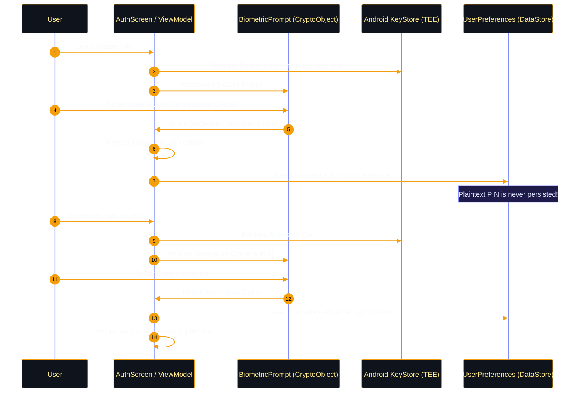

#  Kunjika Architecture

Kunjika uses a local-first architecture with Android Keystore and encrypted local storage. Hardware backing varies by device, and Bluetooth, operating-system integrations, and the receiving computer remain in scope.

---

##  High-Level Component Architecture

The architecture encrypts vault data at rest and uses authenticated encryption for Web Drop payloads in transit. The Android app removes its `INTERNET` permission; Bluetooth and other operating-system integrations are still communication channels.

```mermaid
%%{init: {
  'theme': 'base',
  'themeVariables': {
    'darkMode': true,
    'background': '#07090E',
    'mainBkg': '#0F141C',
    'primaryColor': '#131A26',
    'primaryTextColor': '#F8FAFC',
    'primaryBorderColor': '#F59E0B',
    'lineColor': '#818CF8',
    'clusterBkg': '#0F141C',
    'clusterBorder': '#2B374A',
    'edgeLabelBackground': '#18202E'
  }
}}%%
graph TB
    %% Definitions
    subgraph UI [" UI Layer (Jetpack Compose & Material 3)"]
        Nav[MainNavigation]
        Auth[Auth Screen]
        Gen[Generator Screen & History]
        Vault[Vault Screen]
        Audit[Security Audit & Integrity]
        Settings[Settings Screen]
        WebDrop[Web Drop Scanner Dialog]
        Glossy[Glossy Design System]
    end

    subgraph VM [" ViewModel Layer"]
        AVM[AuthViewModel]
        GVM[GeneratorViewModel]
        VVM[VaultViewModel]
        SVM[SettingsViewModel]
    end

    subgraph Domain [" Security & Core Logic"]
        direction LR
        BC[BlockchainManager]
        KE[KeystoreManager]
        QR[QrEncryptionManager]
        BK[BiometricKeyManager]
        TOTP[TotpManager]
        WDC[WebDropCrypto]
        BLE[KunjikaBlePeripheral]
        SEC[SecurityManager]
        PIM[PlayIntegrityManager]
    end

    subgraph Data [" Data Layer (Persistence)"]
        Repo[PasswordRepository]
        Room[(Room + SQLCipher)]
        DS[(UserPreferences / DataStore)]
    end

    %% Connections
    Nav --> Auth & Gen & Vault & Audit & Settings
    Auth & Gen & Vault & Audit & Settings -.-> Glossy
    Auth --> AVM
    Gen --> GVM
    Vault --> VVM
    Audit --> VVM
    Settings --> SVM
    Vault -.-> WebDrop

    GVM & VVM & SVM --> Repo
    AVM & SVM --> DS
    
    Repo --> BC & KE & TOTP
    Repo --> Room
    
    VVM --> QR & WDC & BLE
    AVM --> BK & SEC & PIM
    Audit --> SEC & PIM

    %% Styling with Obsidian Gold & Midnight Indigo
    classDef ui fill:#131A26,stroke:#F59E0B,stroke-width:1.5px,color:#FDE68A;
    classDef vm fill:#1E1B4B,stroke:#818CF8,stroke-width:1.5px,color:#E0E7FF;
    classDef core fill:#064E3B,stroke:#34D399,stroke-width:1.5px,color:#A7F3D0;
    classDef data fill:#18202E,stroke:#FBBF24,stroke-width:1.5px,color:#FDE68A;

    class UI,Nav,Auth,Gen,Vault,Audit,Settings,WebDrop,Glossy ui;
    class VM,AVM,GVM,VVM,SVM vm;
    class Domain,BC,KE,QR,BK,TOTP,WDC,BLE,SEC,PIM core;
    class Data,Repo,Room,DS data;

    style UI fill:#0F141C,stroke:#F59E0B,stroke-width:2px,color:#FDE68A
    style VM fill:#151238,stroke:#818CF8,stroke-width:2px,color:#C7D2FE
    style Domain fill:#052e25,stroke:#34D399,stroke-width:2px,color:#A7F3D0
    style Data fill:#18202E,stroke:#FBBF24,stroke-width:2px,color:#FDE68A
```

> [!NOTE]
> **Layered Decoupling**: The **UI Layer** interacts through **ViewModels**, delegating cryptographic operations to security managers. Vault records are stored in Room + SQLCipher; DataStore contains app preferences and PIN-related values, some of which are separately wrapped or hashed.

---

##  Core Data Flows

### 1. Double-Lock Encryption Flow
Kunjika implements a two-stage encryption pipeline:
1. **Selected-Field Encryption**: Password and TOTP secret values use AES-256-GCM with an Android Keystore key. Other record metadata is protected by the encrypted SQLCipher database, not individually field-encrypted.
2. **Database-Level Encryption**: SQLCipher uses a random passphrase wrapped by Android Keystore. The Master PIN gates the app UI; it is not the database key. Hardware backing varies by device.

### 2. Biometric-Authorized PIN Storage Flow
To achieve instant biometric unlock without compromising PIN entropy or persisting plaintext:

### 3. Local Signed Audit Chain
Mutations write signed entries to a local hash chain:
- **Vault Row Digest**: HMAC-SHA-256 of the modified serialized row using a Keystore-held key.
- **Keystore Signature**: Signed with an elliptic curve (`secp256r1`) private key in Android Keystore; hardware backing varies by device.
- **Signed Hash Chain**: Blocks link to the previous block and use a local Keystore signing key. This is tamper-evident for some edits, but cannot reliably detect full deletion, tail truncation, or compromise of the running app.

### 4. Environmental Integrity & Tamper Protection
Before granting access to sensitive cryptographic operations:
- **Root Verification**: Checks for `su` binaries across system locations, inspects `Build.TAGS` for `test-keys`, and executes a runtime `which su` probe.
- **Emulator Verification**: Inspects build properties, brand/device markers, hardware signatures (`goldfish`, `ranchu`), and product names (`google_sdk`, `vbox86p`).
- **Keystore Security Level**: Reports whether Android Keystore identifies a key as software, TEE, or StrongBox backed. This is a device-provided signal, not independent attestation.
- **Play Integrity API**: The client can request a token. Without a backend verifying that token, the app does not have a trusted integrity verdict.

### 5. Direct Web Drop Flow (BLE GATT with Reassembly)
Enables secure transmission of passwords to desktop browsers without network access:
- **Ephemeral ECDH and HKDF**: Both sides derive transcript-bound keys from ephemeral P-256 keys, the session ID, and both public keys.
- **Pairing confirmation**: After biometric authorization, both screens show a six-digit comparison code. The browser requires a confirmation click before the phone can release the credential.
- **Per-session BLE service**: A random service UUID is advertised only after biometric approval; the phone sends AES-256-GCM ciphertext over BLE.
- **Audit Log**: An `EXPORT_BLE` event is appended to the local signed audit chain, which can detect some edits but is not immutable.

---

##  Technology Stack & Dependencies

| Component | Technology | Version | Purpose |
| :--- | :--- | :--- | :--- |
| **Language** | Kotlin | `2.4.21` | Android app implementation |
| **Build System** | Android Gradle Plugin (AGP) | `9.4.1` | Android build toolchain |
| **Compiler Plugin** | KSP (Kotlin Symbol Processing) | `2.3.12` | Room annotation processing |
| **UI Toolkit** | Jetpack Compose (BOM) | `2026.09.00` | Declarative UI with Material 3 |
| **Navigation** | Navigation Compose | `2.10.2` | In-app navigation |
| **Database** | Room + SQLCipher | `2.8.5` / `4.19.1` | Encrypted local SQLite database |
| **Biometrics** | AndroidX Biometric | `1.1.0` | Biometric authentication & `CryptoObject` |
| **Integrity Signal** | Google Play Integrity | `1.6.0` | Requests a Play Integrity token; this project has no backend to verify it |
| **Preferences** | Jetpack DataStore | `1.2.1` | Local key-value settings |
| **Camera & Barcode** | CameraX + ML Kit Barcode | `1.4.1` / `17.3.0` | QR code scanning for offline sync |
| **Bluetooth** | Android Bluetooth Low Energy | Android platform API | BLE GATT peripheral server for Web Drop |
| **Desktop Companion**| HTML5 / Vanilla JS / WebCrypto | Native | Browser receiver with best-effort memory cleanup |
