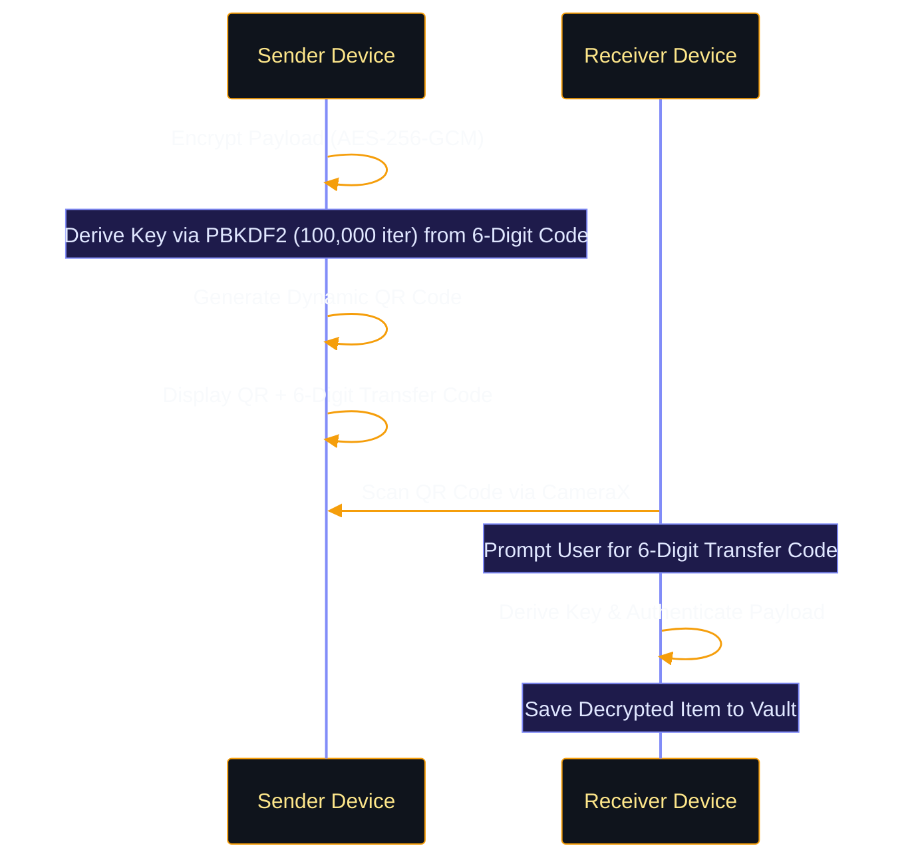

# ✨ Kunjika Features

[](../RELEASE_NOTES.md)
[](features.md)
[](features.md)
[](features.md)

Kunjika combines local encrypted storage and offline transfer options with a modern interface. Bluetooth and receiving-device security remain part of the user's security boundary.

---

## 🚀 Key Modules

### 1. Smart Generator Engine (4-in-1)
Kunjika features an intelligent, multi-mode cryptographic generator designed for diverse authentication scenarios:

- **Password Mode**:
  - Real-time bit-entropy calculation and "Time-to-Crack" estimation.
  - Granular character set controls (uppercase, lowercase, digits, symbols).
  - Ambiguity filter (excludes confusing characters like `l`, `1`, `I`, `O`, `0`).
- **Passphrase Mode**:
  - Cryptographically secure Diceware-style generation using an offline 10,000-word dictionary.
  - Configurable word counts (3 to 8 words) and custom separators (`-`, `_`, `.`, ` `).
- **Numeric PIN Mode**:
  - High-entropy random numeric passcode generation of custom length (4 to 12 digits).
- **TOTP Secret Generation Mode**:
  - Generates RFC 6238-compliant 160-bit Base32 secret keys for setting up two-factor authentication.
  - One-tap copy or direct bookmarking into the vault.
- **Manual Generation Workflow & History**:
  - Passwords and tokens are generated strictly upon explicit user request ("Generate" / "Regenerate"), avoiding clutter and accidental overwrites.
  - **Persistent Generation History**: Access timestamped records of recently generated credentials with instant copy and reuse actions.

---

### 2. The Secure Vault
- **Encrypted Storage**: SQLCipher encrypts the database. Password and TOTP-secret fields also use AES-GCM with Android Keystore keys; metadata is protected by the database encryption, not separately field-encrypted.
- **Built-In TOTP Authenticator**: Integrated two-factor authenticator displaying animated circular countdown timers without needing external apps like Google Authenticator.
- **Categorization & Filtering**: Organize credentials by **Personal**, **Work**, **Finance**, and **Social** with instant search, favorite pinning, and credential strength indicators.
- **Encrypted Secure Notes**: Attach encrypted metadata, recovery keys, and notes to any vault entry.

---

### 3. Encrypted QR Sync (Phone-to-Phone)
Securely transfer credentials between two mobile devices without Bluetooth, Wi-Fi, cell service, or cloud intermediaries.



> [!NOTE]
> **Encrypted QR Sequence**: The payload is encrypted with AES-256-GCM using PBKDF2-HMAC-SHA-256 and a random 16-digit transfer code. The QR and code are shown in separate views; do not photograph or share both.

---

### 4. Direct Web Drop (Phone-to-PC Wireless Sync)
Eliminates manual typing of 32+ character high-entropy passwords on desktop and laptop computers without cloud accounts or relays.

- **No cloud relay during transfer**: Once loaded, the companion communicates directly with the phone over Bluetooth. The page itself is hosted remotely; use a trusted copy, computer, and browser.
- **Ephemeral ECDH P-256 and HKDF-SHA-256**: The session key is derived from both public keys and a one-minute session ID.
- **Pairing code confirmation**: Biometric approval starts BLE advertising. Compare the six-digit codes on both screens, confirm on the browser, then approve sending on the phone.
- **Per-session BLE service UUID**: The phone advertises a random service UUID only after biometric approval.
- **No automatic clipboard copy**: The browser displays the password masked and copies only after a user action. Clipboard history may retain copied content.
- **Best-effort memory cleanup**: Closing the view clears visible fields and drops references; JavaScript cannot guarantee memory erasure.
- **Tamper-evident audit trail**: Web Drop writes an event to a local signed hash chain, with the limits described in the security guide.

```mermaid
%%{init: {
  'theme': 'base',
  'themeVariables': {
    'darkMode': true,
    'background': '#07090E',
    'actorBkg': '#0F141C',
    'actorBorder': '#F59E0B',
    'actorTextColor': '#FDE68A',
    'actorLineColor': '#818CF8',
    'signalColor': '#F59E0B',
    'signalTextColor': '#F8FAFC',
    'labelBoxBkgColor': '#0F141C',
    'labelBoxBorderColor': '#818CF8',
    'labelTextColor': '#F8FAFC',
    'loopTextColor': '#FDE68A',
    'noteBkgColor': '#1E1B4B',
    'noteBorderColor': '#818CF8',
    'noteTextColor': '#E0E7FF',
    'activationBorderColor': '#F59E0B',
    'activationBkgColor': '#131A26',
    'sequenceNumberColor': '#07090E'
  }
}}%%
sequenceDiagram
    autonumber
    participant Browser as 💻 Web Companion (Browser)
    participant Phone as 📱 Kunjika App (Android)
    participant BLE as 📡 Web Bluetooth (GATT)

    Browser->>Browser: Generate Ephemeral P-256 ECDH Keypair
    Browser->>Browser: Render One-minute QR (Session ID + PubKey + BLE Service UUID)
    Phone->>Browser: Scan QR with CameraX
    Phone->>Phone: Validate session; derive transcript-bound HKDF keys
    Phone->>Phone: User biometric approval before BLE advertising
    Phone->>BLE: Start GATT server with per-session UUID
    Browser->>BLE: Connect & Subscribe to Characteristic e9a30002
    BLE->>Browser: Phone public key; derive and display pairing code
    User->>Browser: Compare codes and confirm on browser
    User->>Phone: Compare codes and approve send
    Phone->>BLE: Stream Chunked AES-256-GCM Ciphertext (with Retries)
    Browser->>Browser: Decrypt with WebCrypto & Display Masked Password
    Phone->>Phone: Record EXPORT_BLE Block in Local Blockchain
    User->>Browser: Close transfer view for best-effort visible-field cleanup
```

---

### 5. Security Audit & Environmental Health
The Security Audit suite provides proactive threat detection and integrity analysis:

- **Vulnerability Scanner**: Identifies weak passwords, reused credentials, old credentials (>90 days), and missing 2FA configurations.
- **Real-Time Root Detection**: Deep checks for `su` binaries across system paths (`/sbin/su`, `/system/xbin/su`, `/data/local/su`), `test-keys` OS builds, and execution probe verification.
- **Emulator Environment Detection**: Heuristic detection of emulated virtual machines (goldfish/ranchu hardware, generic build props, QEMU signatures).
- **Keystore Security Level**: Reports Android's declared security level (software, TEE, or StrongBox when available); this is not independent attestation.
- **Google Play Integrity API**: The client can request a token; a trusted verdict requires a backend to verify it.
- **Signed Audit Chain**: One-tap chain validation detects some changes but cannot reliably detect complete deletion, tail truncation, or app compromise.

---

### 6. Visual Identity & Dual-Theme Engine
- **Obsidian Gold & Midnight Indigo (Default Luxury Dark)**:
  - Deep Obsidian surface (`#07090E`), elevated card layers (`#0F141C`, `#18202E`).
  - Warm 24k Gold accents (`#F59E0B`, `#FBBF24`) and Cryptographic Indigo (`#818CF8`, `#6366F1`).
- **Platinum Silver (Light Mode)**:
  - Clean metallic surfaces (`#F8FAFC`, `#CBD5E1`) with high-contrast typography.
- **Glossy UI Components**:
  - `GlossyCard`, `GlossyButton`, `GlossyBadge`, and `GlossyTextField` with specular top-shine gradients, frosted glass borders, and smooth spring animations.
- **Web Companion Matching Themes**:
  - Seamless theme toggle on desktop browser matching the mobile visual identity.

---

### 7. System Integration & Access Control
- **Biometric-Backed PIN Storage**: Hardware-bound encryption for the Master PIN using KeyStore TEE ciphers via `BiometricPrompt.CryptoObject`, providing zero-friction instant biometric unlock.
- **Native Android Autofill**: Integrated Autofill framework support for autofilling apps and websites.
- **Screen Capture Protection**: App-wide `FLAG_SECURE` blocks screenshots, screen mirroring, and system app switcher previews.
- **Local Database Passphrase PDF**: Generate an unencrypted copy of the local SQLCipher passphrase. It does not restore field-encrypted entries on a new device; use an encrypted vault export for migration.

---

## 📋 Feature Roadmap
- [x] TOTP Authenticator & Generator
- [x] Persistent Generation History
- [x] Local signed audit chain
- [x] Encrypted QR Sync (Phone-to-Phone)
- [x] Direct Web Drop (Web Bluetooth + transcript-based pairing confirmation)
- [x] PBKDF2 PIN Hashing (600,000 iterations for newly set PINs)
- [x] Biometric-Backed PIN Storage (TEE unwrap)
- [x] Google Play Integrity API Integration
- [x] Obsidian Gold & Platinum Dual-Theme System
- [x] Real-Time Root & Emulator Detection
- [ ] Multi-Vault Separation
- [ ] Secure Notes File Attachment
- [ ] Dedicated Desktop Browser Extension
