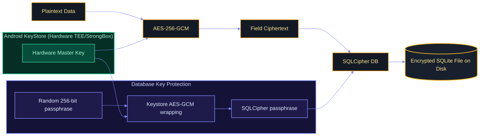
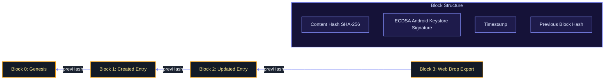
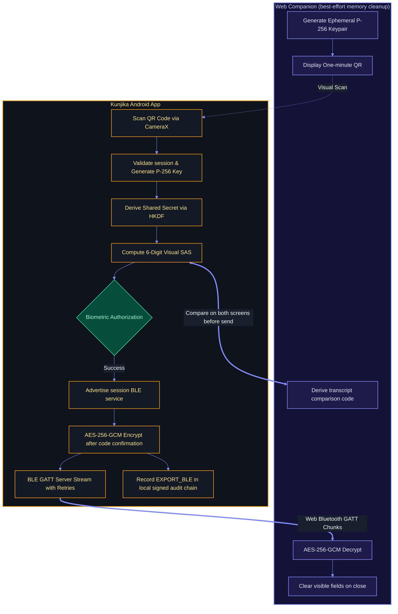

#  Security Deep-Dive

Kunjika is designed for local-first use. The Android manifest removes the app's `INTERNET` permission, but Bluetooth, operating-system services, clipboard integrations, backups, and a receiving computer remain part of the security boundary. Keystore hardware backing depends on the device and is not guaranteed everywhere.

---

##  Encryption Strategy: "Double-Lock" Architecture

Kunjika does not simply encrypt the database file; it encrypts every sensitive field *before* it is written to an encrypted database.

> [!NOTE]
> **At-rest protection**: SQLCipher uses a random passphrase wrapped by Android Keystore, while selected fields use a Keystore key. Root access or code execution as the app can invoke these keys and bypass the app PIN; hardware backing varies by device.

### 1. Hardware Security Module (Android KeyStore)
Cryptographic keys are generated in Android Keystore. Hardware backing is device-dependent and is reported only when the platform confirms TEE or StrongBox:
- **Master Encryption Key**: AES-256-GCM key used for field-level credential encryption.
- **Identity Key**: Elliptic curve (`secp256r1`) key used to sign local audit-chain blocks.
- **Biometric Key**: AES-256 key initialized with `setUserAuthenticationRequired(true)` when biometric unlock is configured.

### 2. Database Protection (SQLCipher)
- **Random Database Passphrase**: SQLCipher uses a random 256-bit passphrase stored wrapped by Android Keystore. The Master PIN is an app access gate, not the database key.
- **PIN Verification**: Newly set PINs use PBKDF2-HMAC-SHA-256 at 600,000 iterations with exponential app-level delays after failures. Root access can bypass the app and reset app data; existing PINs shorter than six digits should be changed.
- **No Static Keys**: There are no hardcoded or static decryption keys anywhere in the application code.

---

##  Biometric PIN Unlock

Biometric unlock uses Android Keystore to protect a stored PIN for convenience. The PIN is not persisted as plaintext, but it is used in app memory during authentication; app code cannot guarantee secure erasure from memory.

1. **Authentication-Gated Cipher**: When biometrics are enabled, an AES-256-GCM key is generated in Android Keystore requiring biometric authorization for its use (`setUserAuthenticationRequired(true)`). Hardware backing depends on the device.
2. **Cryptographic Wrapping**: Upon successful initial PIN entry and biometric verification, the Master PIN is encrypted using the authenticated `BiometricPrompt.CryptoObject` cipher.
3. **Persisting Encrypted Payload**: The resulting ciphertext and initialization vector (IV) are persisted in `UserPreferences`. The PIN may exist temporarily in app memory during unlock; secure erasure cannot be guaranteed for Kotlin/Java strings.
4. **Biometric Unwrapping**: On subsequent app launches, a biometric prompt authorizes the KeyStore cipher to decrypt the stored PIN directly into volatile memory for database unlocking. If biometrics are modified or removed at the OS level, the KeyStore key is automatically invalidated by Android.

---

##  Local Signed Audit Chain

Kunjika maintains a locally signed hash chain intended to make some edits detectable. It is not an immutable blockchain and cannot reliably detect full ledger deletion, tail truncation, or an attacker controlling the app and its signing environment.

- **Vault Record Digest**: HMAC-SHA-256 of serialized vault row data with a Keystore-held key to resist offline guessing from ledger-only copies. Other audit event digests are not password hashes.
- **Device Keystore Signature**: Signed with a private EC key (`secp256r1`) in Android Keystore; hardware backing varies by device.
- **Cryptographic Chain**: Each block points to the previous block's SHA-256 hash. This can detect some edits, but cannot reliably detect full ledger deletion, tail truncation, or rollback.

---

##  Environmental Integrity & Tamper Protection

Kunjika incorporates multi-layered runtime environmental checks to detect compromised execution environments:

### 1. Real-Time Root Detection
- **Build Tags Analysis**: Scans `Build.TAGS` for `test-keys` indicative of custom, rooted ROMs.
- **System Binary Detection**: Probes filesystem paths for presence of the `su` binary across `/sbin/su`, `/system/bin/su`, `/system/xbin/su`, `/data/local/xbin/su`, `/system/sd/xbin/su`, and `/system/app/Superuser.apk`.
- **Runtime Execution Probe**: Spawns an isolated sub-process executing `which su` to catch stealth root managers that hide binaries from standard directory listings.

### 2. Emulator Environment Detection
Heuristic scanning flags emulated environments to prevent dynamic analysis in automated sandboxes:
- Checks build attributes for `generic`, `unknown`, `google_sdk`, `Android SDK built for x86`, and `vbox86p`.
- Inspects hardware configuration strings for `goldfish` and `ranchu` emulation architectures.
- Identifies virtualized manufacturers such as `Genymotion`.

### 3. KeyStore Security Level
- Reports Android's key security level (software, TEE, or StrongBox where available). This is device-reported information, not independent key attestation.

### 4. Google Play Integrity API
- The app can request an integrity token. Without backend verification, it does not provide the app with a trusted integrity verdict.

---

##  Direct Web Drop Cryptographic Protocol

Web Drop transfers a selected credential directly over Bluetooth without a cloud relay or account. The hosted companion page needs to be loaded in the browser first, and the receiving computer must be trusted.

### Cryptographic Guarantees:
1. **Short-lived QR sessions**:
   - The phone enforces a 60-second time window and remembers recently consumed session IDs while its process remains alive. This does not authenticate the companion page.
2. **Ephemeral ECDH P-256 Key Agreement**:
   - Both devices generate single-use EC P-256 keypairs.
   - Android parses the browser's 65-byte uncompressed public key (`0x04 || X || Y`) and computes the Diffie-Hellman shared secret.
   - HKDF-SHA-256 derives separate encryption and pairing-code keys, bound to the session ID and both public keys.
3. **Visual Short Authentication String (SAS)**:
   - Both devices derive a six-digit comparison code from the session transcript. After biometric authorization, the user compares both screens and confirms on the browser before approving the send on the phone.
4. **Hardware Biometric Authorization**:
   - Android `BiometricPrompt` (`BIOMETRIC_STRONG`) must succeed before BLE advertising begins.
5. **BLE GATT Transfer with Reliable Chunking**:
   - Phone advertises a per-session random GATT service UUID only after biometric approval.
   - Transmits AES-256-GCM ciphertext in sequence-numbered chunks with notification retries for error-free delivery.
6. **Best-effort cleanup**:
   - The browser does not automatically copy passwords. Closing the transfer view clears visible credential fields and drops references, but JavaScript cannot guarantee memory erasure or delete operating-system clipboard history.
7. **Local Audit Trail**:
   - Web Drop records an `EXPORT_BLE` event in the local signed audit chain. The chain can help detect some edits but is not immutable and cannot guarantee detection of deletion or rollback.

---

##  Backup Security & Cache Purging
- **Encrypted Vault Backups**: Password-protected vault exports encrypted with AES-256-GCM using PBKDF2 key derivation.
- **Recovery kit cleanup**: The generated PDF is deleted from app cache after a delay. Deletion does not guarantee physical erasure on flash storage; protect the PDF and delete exported copies yourself.
