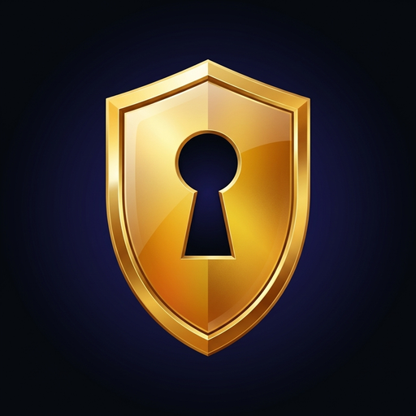
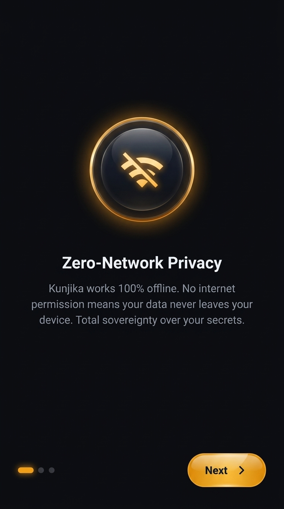
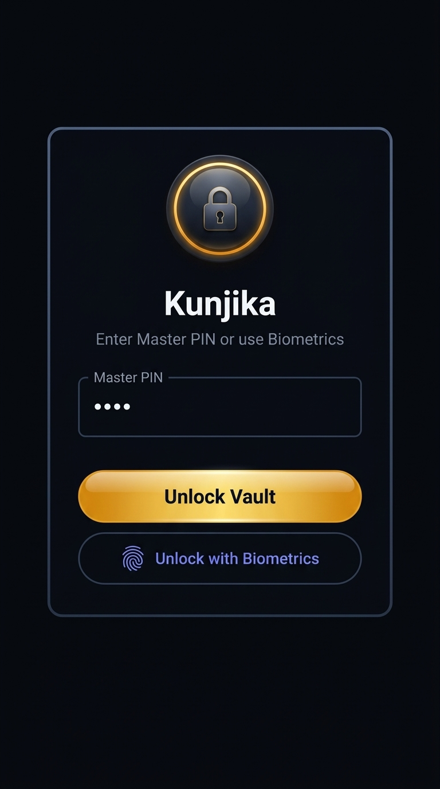
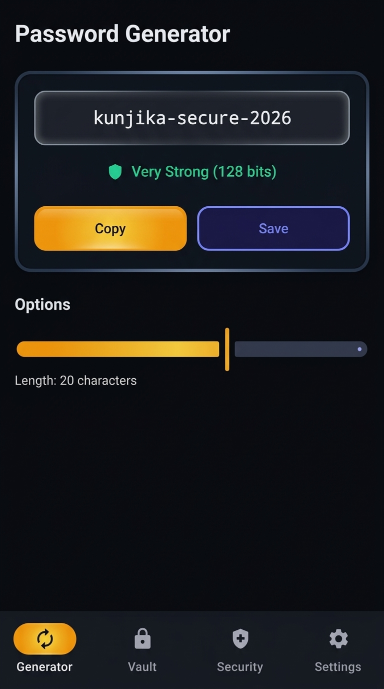
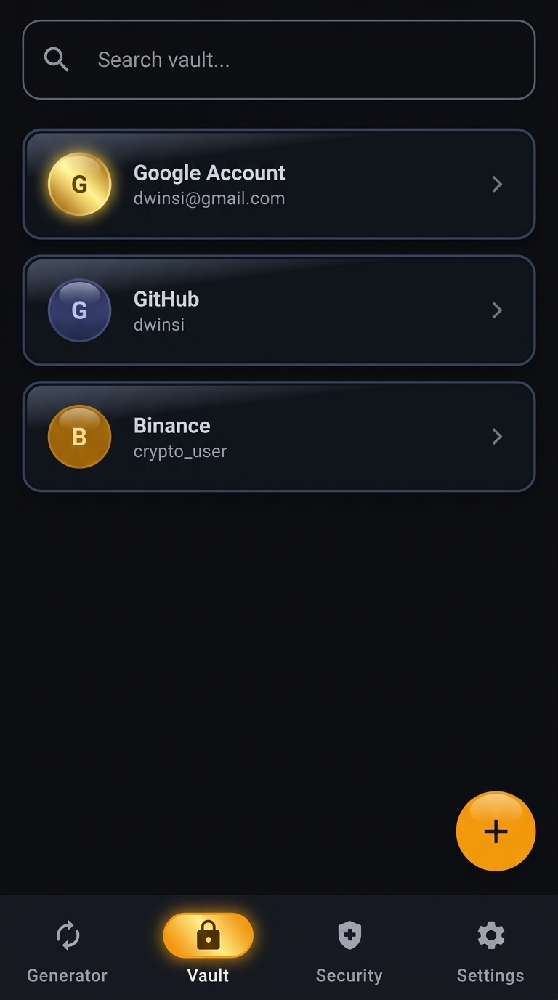

<div align="center">
  
  <h1>Kunjika User Guide & Quickstart</h1>
  <p><em>Local-first encrypted password vault for Android</em></p>
</div>

[](../RELEASE_NOTES.md)
[](security.md)
[](https://dwinsi.github.io/kunjika/web-companion/)
[](../testing.html)

> 🧪 **Closed Beta Tester?** Open the interactive mobile-friendly checklist with progress tracking and quick copy templates:  
> 👉 **[Launch the 14-Day Play Store Testing Portal](../testing.html)** *(Interactive day tracker, 1-minute daily missions & review guides)*

Welcome to **Kunjika**! If you are new to the app, this guide will help you understand how it works, how to set it up, and how to use all of its features in your day-to-day life.

---

## 📌 What is Kunjika? (In Simple Words)

Most password managers (like Chrome, LastPass, or 1Password) save your passwords on their cloud servers over the internet. If their servers ever get breached, your logins could be leaked.

**Kunjika has no Android internet permission.**
- The app cannot make ordinary internet connections, but it can share data through Bluetooth, QR, clipboard, Android Autofill, and user-controlled exports.
- Outbound data transfer occurs strictly under your explicit, biometric-authorized control via local channels: **Direct Web Drop** (Bluetooth BLE to your PC) or **Encrypted QR** (phone-to-phone).
- Android Keystore protects key material; hardware backing depends on the device and must not be assumed.
- **You** own the keys. No accounts to create, no monthly subscriptions, and zero tracking.

---

## 🚀 Quick Setup (First Launch)

When you open Kunjika for the first time, getting set up takes less than a minute.

| 1. Welcome Screen | 2. Master PIN & Biometrics |
| :---: | :---: |
|  |  |
| *Local storage overview* | *Create a Master PIN and enable biometrics* |

### Step 1: Review Onboarding
Swipe through the quick onboarding screens explaining how Kunjika keeps your credentials safe offline.

### Step 2: Set Your Master PIN
- Pick a memorable **Master PIN of at least 6 digits**.
- Confirm your PIN.

> [!WARNING]
> **Keep your Master PIN safe.** It gates app access but is not the database encryption key. An encrypted export or printed database passphrase may help with recovery; the printed passphrase alone does not restore entries on a different phone.

### Step 3: Enable Biometrics (Fingerprint / Face Unlock)
- Tap **Unlock with Biometrics** to link your fingerprint or face recognition.
- From now on, you can unlock your vault in less than a second with your fingerprint!

---

## 🧭 Navigating the App (The 4 Main Tabs)

At the bottom of your screen, you will find 4 main sections:

```
┌──────────────┬──────────────┬──────────────┬──────────────┐
│  🔄 Generator │   🔒 Vault   │  🛡️ Security │  ⚙️ Settings  │
└──────────────┴──────────────┴──────────────┴──────────────┘
```

1. **🔄 Generator**: Create super-strong passwords, memorable word passphrases, numeric PINs, and 2FA secrets.
2. **🔒 Vault**: Your encrypted safe where all your saved accounts, logins, and notes live.
3. **🛡️ Security**: A health dashboard that spots weak or reused passwords and checks your phone's safety.
4. **⚙️ Settings**: Change themes (Obsidian Gold or Platinum Silver), enable Android Autofill, and back up your vault.

---

## 💡 Common Use Cases & How to Use Them

---

### Use Case 1: Creating a Strong Password or Passphrase

Whenever you create a new account on a website or need to change an existing password, use the **Generator** tab.

<div align="center">
  
  <p><em>The Generator tab: real-time strength meter, slider, and quick Copy / Save buttons</em></p>
</div>

#### How to generate a password:
1. Tap the **Generator** tab at the bottom.
2. Choose your generation style:
   - **Password (Default)**: Random mix of letters, numbers, and symbols (e.g., `k8#Q!v9$L2z*M`).
   - **Passphrase (Diceware)**: Multiple easy-to-remember words separated by dashes (e.g., `correct-horse-battery-staple`).
   - **PIN**: Numeric passcode for bank cards or locks (e.g., `839201`).
   - **TOTP Secret**: Cryptographic secret keys for setting up two-factor authentication.
3. Adjust the **Length Slider** (we recommend at least 16–20 characters for passwords, or 4–5 words for passphrases).
4. Watch the **Strength Meter**: It will show whether the password is *Weak*, *Good*, or *Very Strong (128+ bits)*.
5. Tap **Copy** to paste it immediately into your browser or app, or tap **Save** to store it directly in your Kunjika Vault.

> [!TIP]
> **Need a previous password?** Scroll down to the **Generation History** card to find timestamped records of recently generated passwords.

---

### Use Case 2: Saving & Searching Your Logins in the Vault

Store your logins, usernames, passwords, and sensitive notes safely.

<div align="center">
  
  <p><em>The Vault tab: quick search, category filters, and one-tap access</em></p>
</div>

#### How to add a new account:
1. Tap the **Vault** tab at the bottom.
2. Tap the floating **`+` (Add)** button in the bottom right corner.
3. Fill in your account details:
   - **Title**: Service name (e.g., *Google*, *Amazon*, *Work Email*).
   - **Username / Email**: Your login ID.
   - **Password**: Type it or tap the dice icon to auto-generate a secure password.
   - **Category**: Group into *Personal*, *Work*, *Finance*, or *Social*.
   - **2FA Secret (Optional)**: If you want Kunjika to generate your rotating 6-digit authenticator codes.
   - **Notes (Optional)**: Any recovery codes or security questions (these are also encrypted).
4. Tap **Save**.

#### How to find and use a saved password:
- Use the **Search bar** at the top to type the name of the service.
- Tap the account card to open the **Details Dialog**.
- Tap **Copy Password** only when ready to paste it. Clipboard history, keyboard apps, or other software may read or retain copied values; Kunjika does not automatically clear the clipboard.

---

### Use Case 3: Using the Built-In 2FA Authenticator (TOTP)

You no longer need a separate app like Google Authenticator or Microsoft Authenticator!

1. When a website (e.g., GitHub, Google, Binance) asks you to set up Two-Factor Authentication (2FA), it provides a secret key (or text code).
2. Copy that secret key into the **TOTP Secret** field when creating or editing the entry in Kunjika.
3. Once saved, opening that item in Kunjika will display a live **6-digit code** with an animated countdown ring (refreshes every 30 seconds).
4. Tap the 6-digit code to copy it, then paste it into the website to verify your login!

---

### Use Case 4: Beaming Passwords to Your Computer with "Web Drop"

Ever get annoyed trying to manually type a 30-character password like `w9#mK$2P!v8xQ...` from your phone screen onto your laptop keyboard?

**Kunjika Web Drop** solves this problem instantly **without cables, without cloud accounts, and without Wi-Fi**:

```mermaid
%%{init: {'theme': 'base', 'themeVariables': {'darkMode': true, 'background': '#07090E', 'actorBkg': '#0F141C', 'actorBorder': '#F59E0B', 'actorTextColor': '#FDE68A', 'actorLineColor': '#818CF8'}}}%%
sequenceDiagram
    autonumber
    actor User as You
    participant PC as Laptop Browser (Web Drop)
    participant Phone as Kunjika Phone App

    User->>PC: Opens dwinsi.github.io/kunjika/web-companion/
    PC->>PC: Generates pairing QR code & one-time crypto keys
    User->>Phone: Opens account in Vault -> Taps "Web Drop"
    Phone->>PC: Scans QR code displayed on computer screen
    Phone->>Phone: Connects via Bluetooth (BLE)
    Note over PC,Phone: Both screens display matching 6-digit code (e.g. 544 655)
    User->>Phone: Touches fingerprint sensor to approve
    Phone->>PC: Securely beams encrypted password
    PC->>PC: Decrypts and displays masked credential
    Note over PC: Close view to clear displayed fields (best-effort; memory is not guaranteed erased)
```

#### Step-by-Step Instructions:
1. On your computer (Chrome, Edge, Brave, or Opera), open:  
   👉 **[https://dwinsi.github.io/kunjika/web-companion/](https://dwinsi.github.io/kunjika/web-companion/)**
2. On your phone, open Kunjika, tap the account you want to use, and tap **⚡ Web Drop**.
3. Point your phone camera at your computer screen to scan the QR code.
4. Authenticate on the phone to start Bluetooth pairing.
5. Compare the **6-digit Pairing Code** on both screens. Confirm on the browser, then approve sending on the phone.
6. The password appears masked in the browser. Reveal or copy it only when needed; copied text may be retained by clipboard history or other software.
7. Close the transfer view to clear visible fields. JavaScript cannot guarantee that browser memory or clipboard history is erased.

---

### Use Case 5: Transferring Logins to Another Phone (Offline QR Transfer)

Bought a new phone or want to share a Wi-Fi or family password with another device? You can transfer it peer-to-peer using an encrypted QR code without using the cloud or sending text messages.

1. On **Phone A** (Sender):
   - Open the credential in your Vault.
   - Tap **Share via QR**.
   - Kunjika will encrypt the item with AES-256-GCM and display a QR code and temporary **16-digit Transfer Code** separately.
2. On **Phone B** (Receiver):
   - Open Kunjika, go to Vault, and tap **Scan QR Import**.
   - Scan the QR code displayed on Phone A.
   - Enter the 16-digit Transfer Code to decrypt. Older QR transfer formats are no longer accepted because their short codes were vulnerable to offline guessing.
3. The account is instantly imported into Phone B's vault!

---

### Use Case 6: Checking Your Vault Health & Security Status

Tap the **🛡️ Security** tab to audit your passwords and device health:

- **Vault Hygiene**:
  - **Weak Passwords**: Flags passwords shorter than 12 characters.
  - **Reused Passwords**: Alerts you if the same password is used across multiple services (so a breach at one doesn't compromise the others).
  - **Aging Passwords**: Reminds you to rotate passwords that haven't been updated in over a year.
- **Device Environment Audit**:
  - Verifies that your phone is not running unauthorized root modifications or malicious malware debuggers.
  - Reports whether Android confirms hardware-backed Keystore protection; this varies by device and is not remote key attestation.

---

### Use Case 7: Printing the Local Database Passphrase

Kunjika has no Android internet permission, so **you** choose where exported backups are stored.

1. Go to the **⚙️ Settings** tab.
2. Tap **Print Local Database Passphrase**.
3. Authenticate with your fingerprint or Master PIN.
4. Kunjika generates an unencrypted PDF containing the local SQLCipher passphrase. Store it securely.
5. This PDF does not restore entries to a new device because field encryption keys stay in Android Keystore. For migration, create an encrypted vault export and protect it with a strong passphrase.

---

### Use Case 8: Enabling Android Autofill

Tired of copying and pasting? Let Android fill your logins automatically:

1. Open Kunjika and go to **⚙️ Settings**.
2. Tap **Autofill Service**.
3. Select **Kunjika** as your default autofill provider in Android Settings.
4. Next time you open an app or website login form, tap the password box and choose Kunjika to unlock with your fingerprint and fill your credentials with a single tap!

---

## 🧪 14-Day Google Play Closed Testing Guide

> [!IMPORTANT]
> **Why 14-Day Testing is Required for Google Play Store Production Approval:**
> Under Google Play Console policies for personal developer accounts, **at least 20 testers must remain continuously opted-in for at least 14 consecutive days** with demonstrated real-world engagement before Google grants production access to publish Kunjika publicly.
>
> **The 3 Golden Rules for Closed Beta Testers:**
> 1. 📲 **Do NOT uninstall the app** for at least 14 days after opting in. Keeping the app installed is required for the Play Console counter to advance.
> 2. ⚡ **Open and interact with the app regularly** (daily or every 1–2 days). Google tracks active engagement signals; dormant or abandoned installs may cause Google's review system to reject production access.
> 3. 💬 **Submit private feedback on Google Play** during or at the end of your 14-day test cycle.

---

### 📅 14-Day Testing Schedule & Feature Roadmap

To ensure comprehensive test coverage across every feature of Kunjika, follow this recommended day-by-day testing progression:

| Phase | Days | Focus Area | What to Test & Verify |
| :--- | :---: | :--- | :--- |
| **Phase 1** | **Days 1–2** | **Installation & Biometric Onboarding** | • Join via the Google Play Closed Test opt-in link.<br>• Install Kunjika from the Play Store on your Android device.<br>• Complete onboarding and review local storage and transfer boundaries.<br>• Set a **Master PIN of at least 6 digits** and link biometrics.<br>• Test locking and unlocking the app 3–4 times using both PIN and biometrics. |
| **Phase 2** | **Days 3–5** | **Password Generation & Vault Operations** | • Explore all 4 generation styles in the **Generator** tab: Random Passwords, Diceware Passphrases, Numeric PINs, and TOTP Secrets.<br>• Observe the real-time **Entropy & Crack Time Indicator**.<br>• Verify that newly generated items appear in the **Generation History** card.<br>• Add 4–5 sample accounts to the **Vault** across different categories (*Personal*, *Work*, *Finance*, *Social*).<br>• Test the Vault search bar and category filter chips. |
| **Phase 3** | **Days 6–8** | **2FA TOTP Authenticator & Android Autofill** | • Add a 2FA secret key to an account (or test key `JBSWY3DPEHPK3PXP`).<br>• Verify the rotating 6-digit code.<br>• Go to **⚙️ Settings > Autofill Service** and set Kunjika as your Android default.<br>• Unlock Kunjika first. Autofill uses exact saved web host matching and is unavailable while the vault is locked. |
| **Phase 4** | **Days 9–11** | **Web Drop (PC Sync) & Offline Sharing** | • Use a trusted computer and browser; the hosted companion page is mutable and cannot protect a compromised receiver.<br>• Scan the QR. Authenticate on the phone to start pairing, compare the six-digit codes, confirm on the browser, and approve on the phone.<br>• The browser does not automatically copy the password. Clipboard history may retain anything you copy.<br>• Close the view for best-effort display cleanup; memory erasure is not guaranteed.<br>• *(Optional)* Test phone-to-phone encrypted QR transfer. |
| **Phase 5** | **Days 12–13** | **Security Audits, Themes & Emergency Backups** | • Open the **🛡️ Security** tab: verify weak/reused password checks, root detection status, and hardware key attestation.<br>• Go to **Settings** and toggle between **Obsidian Gold** and **Platinum Silver** themes.<br>• Test auto-lock timeout behavior by switching between apps or letting the screen turn off.<br>• Generate an **Emergency Recovery Kit** in Settings and inspect the exported offline document. |
| **Phase 6** | **Day 14+** | **Google Play Store Feedback & Continuous Opt-In** | • Open Kunjika's listing in the **Google Play Store** app.<br>• Tap **Leave feedback for developer** to share your testing experience.<br>• **Keep Kunjika installed** until the developer announces official public launch! |

---

### 🧪 High-Priority Test Cases & Edge Cases to Try

Try executing these specific scenarios to help uncover edge cases and stress-test the app:

#### 1. ✈️ 100% Offline Airplane Mode Test
* Turn on **Airplane Mode** (disable Wi-Fi and Mobile Data entirely).
* Open Kunjika, generate credentials, edit vault items, and test biometrics.
* **Expected Result**: Kunjika functions flawlessly with 0% network reliance and no network timeout errors.

#### 2. 🛡️ Screen Privacy & Anti-Spyware Protection (`FLAG_SECURE`)
* Attempt to take a screenshot inside the app (`Power + Volume Down`).
* Open Android's Recent Apps / App Switcher view.
* **Expected Result**: Android blocks screenshot capture (or displays a security warning) and blanks the preview card in the app switcher, preventing malware from capturing passwords.

#### 3. ⏱️ Clipboard Clearing Check
* Copy a password or TOTP code from the Vault.
* Paste it into a text note and wait 30–45 seconds.
* Try pasting again.
* **Expected Result**: Kunjika marks copied secrets as sensitive where supported, but does not clear the clipboard. Other apps or clipboard history may retain copied content.

#### 4. 🔒 Rate Limiting & Master PIN Protection
* Lock Kunjika and intentionally enter an incorrect PIN several times.
* **Expected Result**: The app should enforce progressive delays/vibrations and lock out repeated brute-force attempts.

#### 5. 🔄 App Lifecycle & Auto-Lock Test
* Unlock Kunjika, navigate to your vault, and switch to another app (e.g., Settings or YouTube) for 2 minutes.
* Return to Kunjika.
* **Expected Result**: Kunjika should immediately require biometric or Master PIN re-authentication before displaying your vault items.

---

### 💬 How to Submit Helpful Feedback on Google Play

Constructive tester feedback in the Play Store provides critical proof of active testing during Google's review process.

#### Step-by-Step Instructions:
1. Open the **Google Play Store** app on your testing phone.
2. Tap your profile picture in the top-right corner -> **Manage apps & device**.
3. Under the **Installed** tab, find **Kunjika (Beta / Early Access)** and tap it.
4. Scroll down to the **Private feedback to developer** section.
5. Tap the text box, write your feedback, and tap **Submit**.

#### What to Mention in Your Feedback:
* **Your Device & OS**: (e.g., *Google Pixel 8, Android 15* or *Samsung Galaxy S24, One UI 6.1*)
* **What Worked Well**: (e.g., *Instant biometric unlock, smooth TOTP timer, fast Web Drop pairing*)
* **Any Issues or Usability Quirks**: (e.g., *Autofill suggestion positioning, button touch targets, or contrast in bright sunlight*)
* **Performance**: (e.g., *App launches instantly, zero lag, smooth 60/120fps animations*)

> [!CAUTION]
> **Please do NOT uninstall Kunjika on Day 14!**
> Google Play reviews the production access application after the 14-day mark. If testers uninstall immediately on day 14 while the review is pending, the active tester count may fall below 20, causing Google to reset the testing cycle. Please keep Kunjika installed until the app is officially approved and live.

---

## ❓ Frequently Asked Questions (FAQ)

### Q: Why do I need to keep Kunjika installed for at least 14 continuous days?
Google Play enforces this rule for all personal developer accounts to guarantee that new apps have been tested by real people on real hardware before being distributed to the public. If any tester uninstalls, the 20-tester minimum may be broken, which can reset Google's 14-day progress counter.

### Q: Do I need to use Kunjika every single day of the test?
While you don't need to spend hours in the app, opening it daily or every other day to perform quick tasks (generating a password, viewing an account, or testing autofill) generates active engagement metrics that Google's algorithm evaluates when approving production access.

### Q: Does Kunjika ever send my data to the internet?
**No, never.** Kunjika does not even have the Android Internet permission (`android.permission.INTERNET`) declared in its manifest. Even if someone tried to add tracking code, the Android operating system would physically block any network request.

### Q: What happens if I forget my Master PIN?
The Master PIN is an app access gate, not the SQLCipher key. The recovery PDF contains the local database passphrase but is unencrypted and does not include the Keystore field-encryption keys; use an encrypted `.kunjika` export to migrate entries to another phone.

### Q: Why can't I take screenshots inside the app?
Kunjika enables Android's `FLAG_SECURE` to block ordinary screenshots and hide the app preview in recents. It cannot prevent a compromised OS, accessibility malware, external cameras, or every capture method.

### Q: What happens if I lose my phone, upgrade to a new phone, or replace a damaged device?
Kunjika's **`.kunjika` portable backup files** are encrypted with your custom **Backup Passphrase** using **AES-256-GCM + PBKDF2**. On import, the app decrypts the export and encrypts entries using that phone's Android Keystore. Hardware backing depends on the device.

### Q: How do I save my `.kunjika` backup file to a USB flash drive, SD card, or local folder?
Go to **Settings → Encrypted Offline Backup → Save File**. Kunjika uses Android's official Storage Access Framework (SAF) file picker, allowing you to choose any storage destination—such as a USB-C flash drive, external SD card, or local download folder—completely offline without Kunjika ever needing internet permission.

### Q: How does Kunjika help me remember to back up my passwords?
Kunjika automatically tracks changes to your vault. Whenever you add or edit 5 or more credentials, a discreet **"Backup Recommended"** banner chip appears at the top of your Vault screen to remind you to export a fresh backup before you forget.

### Q: Why does opening the Vault require BOTH my fingerprint AND Master PIN?
Kunjika supports Master PIN and configured biometric unlock. These are app-level access controls; the Master PIN is not combined with the database key, and a compromised/rooted device can bypass app-level controls.

### Q: What are "High-Security Entries" and how do they protect my sensitive accounts?
You can mark critical accounts (like Banking, Crypto Wallets, or Primary Email) as **"High Security"**. Even when your vault is unlocked, viewing, revealing, or copying a High-Security password or 2FA code requires an additional **Biometric Step-Up re-verification**, preventing an attacker who snatched an unlocked phone from accessing your most valuable credentials.

### Q: What is the Anti-Coercion Duress PIN and how does the Decoy Vault work?
Under physical coercion or threat, you can enter a pre-configured secret **Duress PIN** instead of your real Master PIN. Kunjika will open a convincing **Decoy Vault** populated with realistic dummy accounts (e.g. Netflix, Spotify, School), completely concealing your real encrypted passwords.

### Q: Why is there a 5-second countdown timer when I export a backup?
The 5-second safety delay (`5... 4... 3... Cancel`) prevents accidental exports or unauthorized rapid bulk extraction of your vault if someone briefly handles your unlocked device, giving you time to tap "Cancel Export".

### Q: What browsers work with Web Drop?
Web Drop uses the Web Bluetooth standard, which is natively supported in **Google Chrome**, **Microsoft Edge**, **Brave**, and **Opera** on Windows, macOS, Linux, and ChromeOS.

---

## 📚 Need More Technical Details?

For engineers, security auditors, or curious minds:
- **[🏗️ Technical Architecture](architecture.md)** — MVVM structure, KeyStore TEE, and GATT Bluetooth protocol.
- **[🛡️ Cryptographic Security Deep-Dive](security.md)** — Double-Lock encryption, PBKDF2 parameters, and local blockchain audit log.
- **[✨ Full Feature Specifications](features.md)** — Exhaustive list of all app specifications and configurations.
