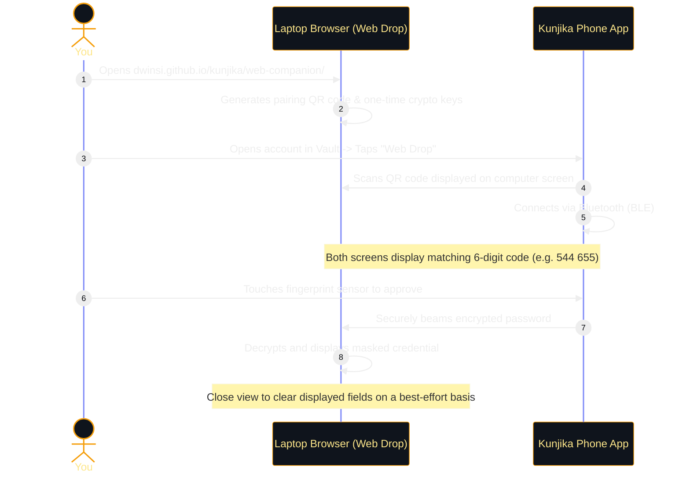

<div align="center">
  
  <h1>Kunjika User Guide & Quickstart</h1>
  <p><em>Local-first encrypted password vault for Android</em></p>
</div>

[](../RELEASE_NOTES.md)
[](security.md)
[](https://dwinsi.github.io/kunjika/web-companion/)
>  **Install Kunjika:** [Open the Google Play listing](https://play.google.com/store/apps/details?id=com.kunjika.app)

Welcome to **Kunjika**! If you are new to the app, this guide will help you understand how it works, how to set it up, and how to use all of its features in your day-to-day life.

---

## What is Kunjika? (In Simple Words)

Kunjika is local-first: it does not require an account or provide cloud synchronization. The Android app removes the `INTERNET` permission, while selected data can still leave the vault through clipboard, Autofill, exports, QR, or Bluetooth actions you initiate.
- Web Drop uses Bluetooth after biometric approval and pairing-code confirmation. The hosted companion page and receiving computer remain part of the trust boundary.
- Android Keystore protects key material; hardware backing depends on the device and must not be assumed.
- No Kunjika account or cloud sync is required. The app has no analytics SDKs configured in this source; the optional Play Integrity request is handled through Google Play services.

---

##  Quick Setup (First Launch)

When you open Kunjika for the first time, getting set up takes less than a minute.

| 1. Welcome Screen | 2. Master PIN & Biometrics |
| :---: | :---: |
|  |  |
| *Local storage overview* | *Create a Master PIN and enable biometrics* |

### Step 1: Review Onboarding
Swipe through the quick onboarding screens explaining how Kunjika keeps your credentials safe offline.

### Step 2: Set Your Master PIN
- Pick a memorable **Master PIN of at least 6 digits**.
- Confirm your PIN.

> [!WARNING]
> **Keep your Master PIN safe.** It gates app access but is not the database encryption key. An encrypted export or printed database passphrase may help with recovery; the printed passphrase alone does not restore entries on a different phone.

### Step 3: Enable Biometrics (Fingerprint / Face Unlock)
- Tap **Unlock with Biometrics** to link your fingerprint or face recognition.
- From now on, you can unlock your vault in less than a second with your fingerprint!

---

##  Navigating the App (The 4 Main Tabs)

At the bottom of your screen, you will find 4 main sections:

```
┌──────────────┬──────────────┬──────────────┬──────────────┐
│   Generator │    Vault   │   Security │   Settings  │
└──────────────┴──────────────┴──────────────┴──────────────┘
```

1. ** Generator**: Create super-strong passwords, memorable word passphrases, numeric PINs, and 2FA secrets.
2. ** Vault**: Your encrypted safe where all your saved accounts, logins, and notes live.
3. ** Security**: A health dashboard that spots weak or reused passwords and checks your phone's safety.
4. ** Settings**: Change themes (Obsidian Gold or Platinum Silver), enable Android Autofill, and back up your vault.

---

##  Common Use Cases & How to Use Them

---

### Use Case 1: Creating a Strong Password or Passphrase

Whenever you create a new account on a website or need to change an existing password, use the **Generator** tab.

<div align="center">
  
  <p><em>The Generator tab: real-time strength meter, slider, and quick Copy / Save buttons</em></p>
</div>

#### How to generate a password:
1. Tap the **Generator** tab at the bottom.
2. Choose your generation style:
   - **Password (Default)**: Random mix of letters, numbers, and symbols (e.g., `k8#Q!v9$L2z*M`).
   - **Passphrase (Diceware)**: Multiple easy-to-remember words separated by dashes (e.g., `correct-horse-battery-staple`).
   - **PIN**: Numeric passcode for bank cards or locks (e.g., `839201`).
   - **TOTP Secret**: Cryptographic secret keys for setting up two-factor authentication.
3. Adjust the **Length Slider** (we recommend at least 16–20 characters for passwords, or 4–5 words for passphrases).
4. Watch the **Strength Meter**: It will show whether the password is *Weak*, *Good*, or *Very Strong (128+ bits)*.
5. Tap **Copy** to paste it immediately into your browser or app, or tap **Save** to store it directly in your Kunjika Vault.

> [!TIP]
> **Need a previous password?** Scroll down to the **Generation History** card to find timestamped records of recently generated passwords.

---

### Use Case 2: Saving & Searching Your Logins in the Vault

Store your logins, usernames, passwords, and sensitive notes safely.

<div align="center">
  
  <p><em>The Vault tab: quick search, category filters, and one-tap access</em></p>
</div>

#### How to add a new account:
1. Tap the **Vault** tab at the bottom.
2. Tap the floating **`+` (Add)** button in the bottom right corner.
3. Fill in your account details:
   - **Title**: Service name (e.g., *Google*, *Amazon*, *Work Email*).
   - **Username / Email**: Your login ID.
   - **Password**: Type it or tap the dice icon to auto-generate a secure password.
   - **Category**: Group into *Personal*, *Work*, *Finance*, or *Social*.
   - **2FA Secret (Optional)**: If you want Kunjika to generate your rotating 6-digit authenticator codes.
   - **Notes (Optional)**: Additional details. Notes are protected by SQLCipher database encryption, not separately encrypted at the field level.
4. Tap **Save**.

#### How to find and use a saved password:
- Use the **Search bar** at the top to type the name of the service.
- Tap the account card to open the **Details Dialog**.
- Tap **Copy Password** only when ready to paste it. Clipboard history, keyboard apps, or other software may read or retain copied values; Kunjika does not automatically clear the clipboard.

---

### Use Case 3: Using the Built-In 2FA Authenticator (TOTP)

You no longer need a separate app like Google Authenticator or Microsoft Authenticator!

1. When a website (e.g., GitHub, Google, Binance) asks you to set up Two-Factor Authentication (2FA), it provides a secret key (or text code).
2. Copy that secret key into the **TOTP Secret** field when creating or editing the entry in Kunjika.
3. Once saved, opening that item in Kunjika will display a live **6-digit code** with an animated countdown ring (refreshes every 30 seconds).
4. Tap the 6-digit code to copy it, then paste it into the website to verify your login!

---

### Use Case 4: Beaming Passwords to Your Computer with "Web Drop"

Ever get annoyed trying to manually type a 30-character password like `w9#mK$2P!v8xQ...` from your phone screen onto your laptop keyboard?

**Kunjika Web Drop** solves this problem instantly **without cables, without cloud accounts, and without Wi-Fi**:



#### Step-by-Step Instructions:
1. On your computer, open the hosted companion page in a Web Bluetooth-compatible browser:
    **[https://dwinsi.github.io/kunjika/web-companion/](https://dwinsi.github.io/kunjika/web-companion/)**
2. On your phone, open Kunjika, tap the account you want to use, and tap ** Web Drop**.
3. Point your phone camera at your computer screen to scan the QR code.
4. Authenticate on the phone to start Bluetooth pairing.
5. Compare the **6-digit Pairing Code** on both screens. Confirm on the browser, then approve sending on the phone.
6. The password appears masked in the browser. Reveal or copy it only when needed; copied text may be retained by clipboard history or other software.
7. Close the transfer view to clear visible fields. JavaScript cannot guarantee that browser memory or clipboard history is erased.

---

### Use Case 5: Transferring Logins to Another Phone (Offline QR Transfer)

Bought a new phone or want to share a Wi-Fi or family password with another device? You can transfer it peer-to-peer using an encrypted QR code without using the cloud or sending text messages.

1. On **Phone A** (Sender):
   - Open the credential in your Vault.
   - Tap **Share via QR**.
   - Kunjika will encrypt the item with AES-256-GCM and display a QR code and temporary **16-digit Transfer Code** separately.
2. On **Phone B** (Receiver):
   - Open Kunjika, go to Vault, and tap **Scan QR Import**.
   - Scan the QR code displayed on Phone A.
   - Enter the 16-digit Transfer Code to decrypt. Older QR transfer formats are no longer accepted because their short codes were vulnerable to offline guessing.
3. The account is instantly imported into Phone B's vault!

---

### Use Case 6: Checking Your Vault Health & Security Status

Tap the ** Security** tab to audit your passwords and device health:

- **Vault Hygiene**:
  - **Weak Passwords**: Flags passwords shorter than 12 characters.
  - **Reused Passwords**: Alerts you if the same password is used across multiple services (so a breach at one doesn't compromise the others).
  - **Aging Passwords**: Reminds you to rotate passwords that haven't been updated in over a year.
- **Device Environment Audit**:
  - Verifies that your phone is not running unauthorized root modifications or malicious malware debuggers.
  - Reports whether Android confirms hardware-backed Keystore protection; this varies by device and is not remote key attestation.

---

### Use Case 7: Printing the Local Database Passphrase

Kunjika has no Android internet permission, so **you** choose where exported backups are stored.

1. Go to the ** Settings** tab.
2. Tap **Print Local Database Passphrase**.
3. Authenticate with your fingerprint or Master PIN.
4. Kunjika generates an unencrypted PDF containing the local SQLCipher passphrase. Store it securely.
5. This PDF does not restore entries to a new device because field encryption keys stay in Android Keystore. For migration, create an encrypted vault export and protect it with a strong passphrase.

---

### Use Case 8: Enabling Android Autofill

Tired of copying and pasting? Let Android fill your logins automatically:

1. Open Kunjika and go to ** Settings**.
2. Tap **Autofill Service**.
3. Select **Kunjika** as your default autofill provider in Android Settings.
4. Next time you open an app or website login form, tap the password box and choose Kunjika to unlock with your fingerprint and fill your credentials with a single tap!

---

## Feature Walkthrough

Use the checklist below to explore Kunjika at your own pace. The old closed-testing schedule has been retired now that the app is publicly listed.

### Useful checks and edge cases

Try executing these specific scenarios to help uncover edge cases and stress-test the app:

#### 1.  Local Features in Airplane Mode
* Turn on **Airplane Mode** (disable Wi-Fi and Mobile Data entirely).
* Open Kunjika, generate credentials, edit vault items, and test biometrics.
* **Expected Result**: Local vault, generator, and authentication features remain available. Online services outside the app, including Play Integrity through Google Play services, may need connectivity.

#### 2.  Screen Privacy & Anti-Spyware Protection (`FLAG_SECURE`)
* Attempt to take a screenshot inside the app (`Power + Volume Down`).
* Open Android's Recent Apps / App Switcher view.
* **Expected Result**: Android blocks screenshot capture (or displays a security warning) and blanks the preview card in the app switcher, preventing malware from capturing passwords.

#### 3.  Clipboard behavior
* Copy a password or TOTP code from the Vault.
* Paste it into a text note.
* **Expected Result**: Kunjika marks copied secrets as sensitive where supported, but does not clear the clipboard. Other apps or clipboard history may retain copied content.

#### 4.  Rate Limiting & Master PIN Protection
* Lock Kunjika and intentionally enter an incorrect PIN several times.
* **Expected Result**: The app should enforce progressive delays/vibrations and lock out repeated brute-force attempts.

#### 5.  App Lifecycle & Auto-Lock Test
* Unlock Kunjika, navigate to your vault, and switch to another app (e.g., Settings or YouTube) for 2 minutes.
* Return to Kunjika.
* **Expected Result**: Behavior follows your configured auto-lock timeout and lock-on-exit settings.

---

### Feedback and support

Open the [Kunjika Google Play listing](https://play.google.com/store/apps/details?id=com.kunjika.app) to leave honest feedback, or use the project support links to report a bug. Include your device model, Android version, and steps to reproduce. Never include passwords or backup files in a report.

---

##  Frequently Asked Questions (FAQ)

### How can I help improve Kunjika?
Share honest feedback through the Play Store listing or report issues through the project support links. Do not include credentials or private backup data.

### Q: Does Kunjika sync my vault to the internet?
Kunjika has no account or cloud-sync service, and the Android app manifest removes the `INTERNET` permission. You can still choose to copy, export, or transfer selected data. The optional Play Integrity token request uses Google Play services; see the privacy policy for details and limitations.

### Q: What happens if I forget my Master PIN?
The Master PIN is an app access gate, not the SQLCipher key. The recovery PDF contains the local database passphrase but is unencrypted and does not include the Keystore field-encryption keys; use an encrypted `.kunjika` export to migrate entries to another phone.

### Q: Why can't I take screenshots inside the app?
Kunjika enables Android's `FLAG_SECURE` to block ordinary screenshots and hide the app preview in recents. It cannot prevent a compromised OS, accessibility malware, external cameras, or every capture method.

### Q: What happens if I lose my phone, upgrade to a new phone, or replace a damaged device?
Kunjika's **`.kunjika` portable backup files** are encrypted with your custom **Backup Passphrase** using **AES-256-GCM + PBKDF2**. On import, the app decrypts the export and encrypts entries using that phone's Android Keystore. Hardware backing depends on the device.

### Q: How do I save my `.kunjika` backup file to a USB flash drive, SD card, or local folder?
Go to **Settings → Encrypted Offline Backup → Save File**. Kunjika uses Android's official Storage Access Framework (SAF) file picker, allowing you to choose any storage destination—such as a USB-C flash drive, external SD card, or local download folder—completely offline without Kunjika ever needing internet permission.

### Q: How does Kunjika help me remember to back up my passwords?
Kunjika does not currently show an automatic backup reminder. Create and verify an encrypted backup periodically, and keep its passphrase separately.

### Q: Do I need both my fingerprint and Master PIN to open the Vault?
No. You can unlock with your Master PIN, and on supported devices you can enable biometric unlock. These are app-level controls; the Master PIN is not the database key, and a compromised/rooted device can bypass app-level controls.

### Q: What are "High-Security Entries" and how do they protect my sensitive accounts?
You can mark selected accounts as **High Security**. Depending on device support and the action, revealing or copying sensitive values can require biometric re-verification. This is an additional app-level check, not protection against a compromised device.

### Q: What is the Anti-Coercion Duress PIN and how does the Decoy Vault work?
The optional **Duress PIN** opens a decoy view with dummy entries instead of the normal vault list. This app-level feature cannot guarantee protection from a person with device access or a compromised operating system.

### Q: Why is there a 5-second countdown timer when I export a backup?
The 5-second delay gives you a chance to cancel an export you did not intend to start. It is a safety prompt, not protection against someone who controls an unlocked device.

### Q: What browsers work with Web Drop?
Web Drop uses the Web Bluetooth standard, which is natively supported in **Google Chrome**, **Microsoft Edge**, **Brave**, and **Opera** on Windows, macOS, Linux, and ChromeOS.

---

##  Need More Technical Details?

For engineers, security auditors, or curious minds:
- **[ Technical Architecture](architecture.md)** — MVVM structure, Android Keystore, and GATT Bluetooth protocol.
- **[ Cryptographic Security Deep-Dive](security.md)** — SQLCipher, PBKDF2 parameters, and the local signed audit chain with its limitations.
- **[ Full Feature Specifications](features.md)** — Exhaustive list of all app specifications and configurations.
